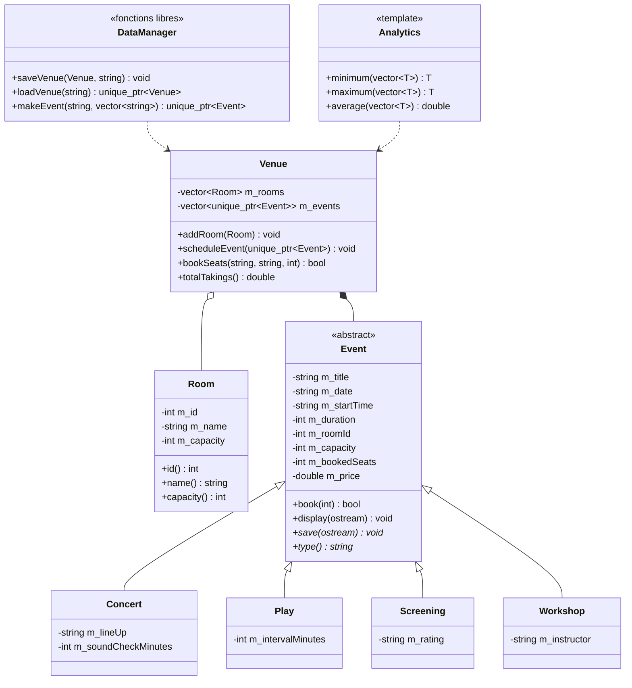

# Diagramme de classes

# Cas d'utilisation

- Visiteur : consulter le programme, rechercher un événement et réserver des places.
- Directeur : consulter les recettes, les statistiques et les salles les plus fréquentées.
- Administrateur : s'authentifier, ajouter une salle et programmer un événement.
- Application : sauvegarder les données et recharger le programme au démarrage.
