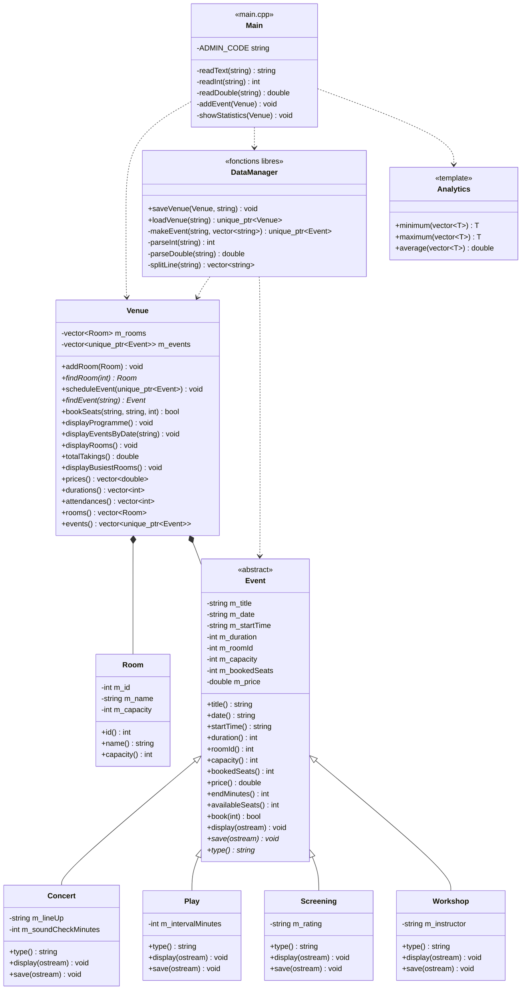

# Diagramme de classes

# Cas d'utilisation

- Visiteur : consulter le programme (complet ou à une date), rechercher un événement par titre, consulter les salles et réserver des places.
- Directeur : consulter les recettes, les statistiques (prix, durées, réservations) et les salles les plus fréquentées.
- Administrateur : s'authentifier avec le code, ajouter une salle et programmer un événement.
- Application : charger `programme.txt` au démarrage, sauvegarder à la demande et à la sortie (sauf si le fichier chargé était invalide).